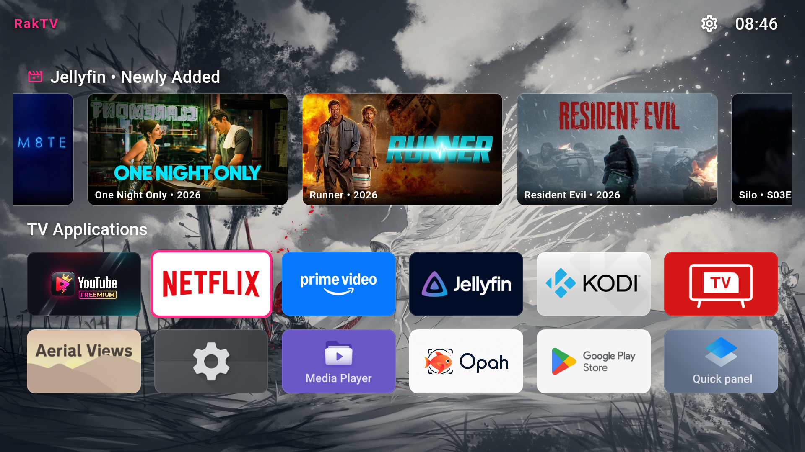
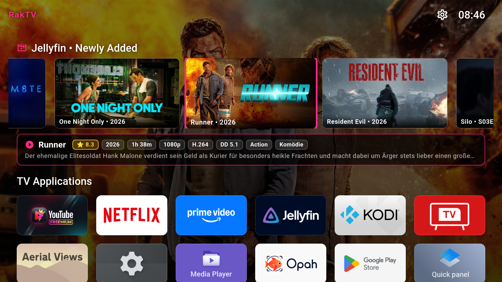
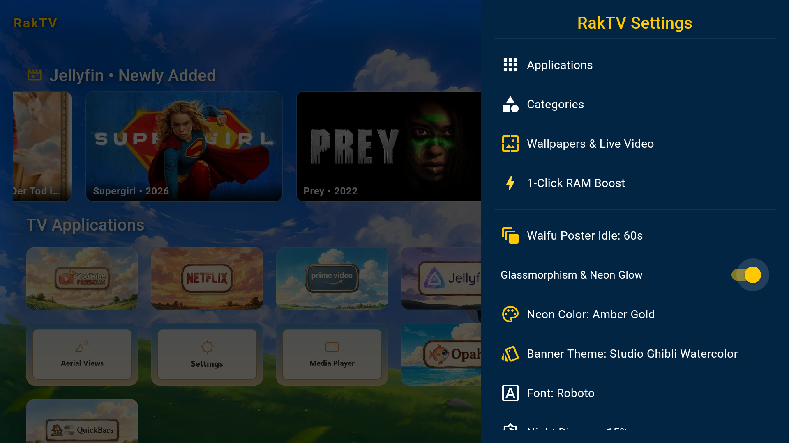
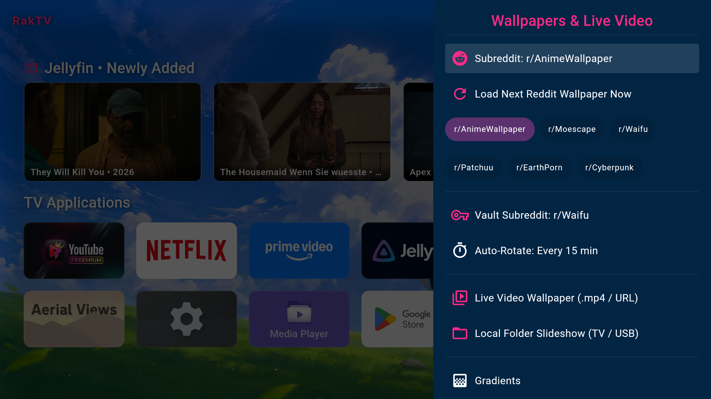
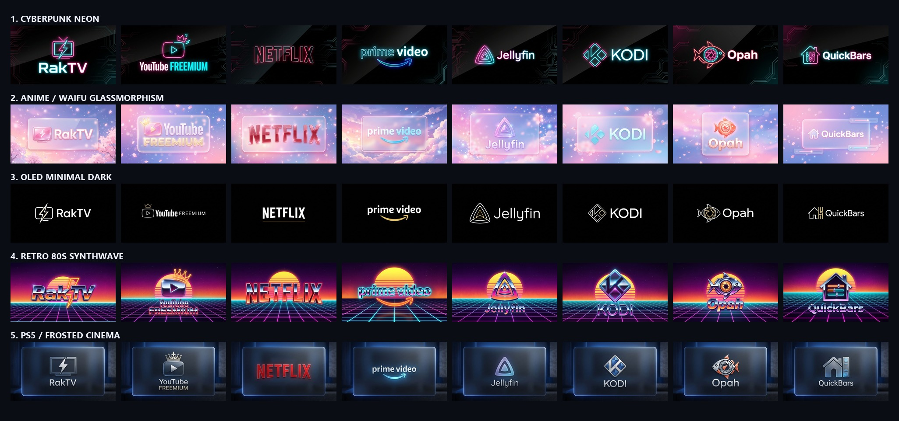

# ⚡ RakTV — 4K Anime, Live-Wallpaper & Jellyfin Android TV Launcher

**RakTV** (`com.denrakeiw.raktv`) is a 100% open-source, zero-telemetry custom Android TV & Google TV launcher featuring **Reddit & Wallhaven 4K Anime Wallpapers**, **`.mp4` Live Video Wallpapers**, **Waifu Poster Auto-Idle Mode**, a **Hidden Konami-Code Vault**, **Custom Per-App Banners**, **Glassmorphism Neon Glow**, and **Native Jellyfin LAN Discovery**.

> ### 🙏 Credits & Original Author Attribution
> **RakTV** is built upon and proudly credits **[FLauncher (`v0.18.0`)](https://gitlab.com/flauncher/flauncher)** created by **Étienne Fesser** (`@etienn01`).
> * **Original Project:** [https://gitlab.com/flauncher/flauncher](https://gitlab.com/flauncher/flauncher)
> * **Original Author:** **Étienne Fesser** (Logo by Katie `@fureturoe`, design by `@FXCostanzo`)
> * **License:** GNU General Public License v3.0 ([`LICENSE`](LICENSE))

---

## 📸 Live Screenshots

### 🏠 Home Screen (Jellyfin 16:9 "Newly Added" Poster Row, 4K Anime Wallpaper, Opah & Custom "YouTube FREEMIUM" Banner)


### 🎬 PS5-Style Dynamic Movie Backdrop Preview (Ratings, Codec Badges & German Overview)


| ⚙️ RakTV Pro & Ultra Settings | 🖼️ 4K Anime & Live Video Wallpaper Studio |
| :---: | :---: |
|  |  |

### 🌸 Waifu Poster Mode (Auto-Idle Fade-Out with Floating Glass Clock)


### 🎨 5 Built-In 1-Click Logo & App Banner Theme Packs (40 Custom 16:9 Tiles)
Switch seamlessly in **RakTV Settings → Banner Theme** between **Cyberpunk Neon**, **Anime / Waifu Glassmorphism**, **OLED Minimal Dark**, **Retro 80s Synthwave**, and **PS5 / Frosted Cinema** (automatically syncs the matching Neon Glow accent color!):



---

## ✨ What's New in RakTV (Pro & Ultra Features — 100% Free & Open Source)

| Feature | Description |
| :--- | :--- |
| 🖼️ **Reddit & Wallhaven 4K Auto-Wallpapers** | Automatically fetches & rotates high-resolution 16:9 4K wallpapers from any subreddit (default: `r/AnimeWallpaper`, `r/Moescape`, `r/Waifu`, `r/Cyberpunk`, or comma-separated multi-subreddits) with automatic **Wallhaven 16:9 4K Anime** fallback. |
| 🎬 **`.mp4` / `.webm` Live Video Wallpapers** | Hardware-accelerated looping video wallpapers (like *Wallpaper Engine* on PC!) from local TV storage, USB drives, or HTTP streams. |
| 📁 **Local Folder Slideshow (TV / USB)** | Scans `/sdcard/Pictures`, `/sdcard/Download`, `/sdcard/Movies`, `/sdcard/Wallpapers`, or custom USB directories for local images and videos. |
| 🌸 **„Waifu Poster Mode“ (Auto-Idle Fade-Out)** | Smoothly fades out all app rows and icons after a configurable idle timer (`30s` / `60s` / `3m` / `5m`) so your TV turns into a pure 4K art frame with a subtle floating glass clock. |
| 🎨 **Custom Per-App Banners & Icons** | Long-press any app card to assign a custom 16:9 PNG/JPG/WebP banner from your TV storage or reset it anytime. |
| 🔒 **Unlimited D-Pad PIN App Lock** | Lock as many apps as you want behind a remote D-Pad directional sequence (`⬆️ ⬆️ ⬇️ ⬇️`). |
| 🕵️ **Secret „Hidden Vault“ (Konami Code)** | Move sensitive apps into the Hidden Vault so they completely disappear from the home screen. Enter **`⬆️ ⬆️ ⬇️ ⬇️ ⬅️ ➡️`** on your remote D-Pad to unlock the Vault row and switch to your secret Vault Subreddit! |
| 🍿 **Native Jellyfin LAN Discovery & Poster Row** | Automatically discovers your local Jellyfin server via UDP port `7359` (`who is JellyfinServer?`), shows live server status (`🟢 JF`), and displays a horizontal *Latest Media* poster row on the home screen. |
| 🎬 **PS5-Style Dynamic Movie Backdrop Preview** | When scrolling across the *Jellyfin • Newly Added* row, the 4K TV background smoothly crossfades to the movie's 16:9 fanart/backdrop and displays an info bar with IMDb/Community Rating (`⭐ 7.8`), year, runtime (`1h 58m`), audio/video codec badges (`1080p • HEVC • DD+ 5.1`), genres, and a 1-line summary. |
| 📹 **Frigate NVR Live Camera & Person Alert PiP** | Automatically discovers your local Frigate AI NVR server and pops up a 10-second live camera Picture-in-Picture overlay in the top-right corner whenever a person is detected (or on demand from Settings). |
| 🎮 **Direct HDMI Input Cards (HDMI 1–3)** | Optional 16:9 HDMI 1–3 passthrough cards using Android TV's native `TvInputManager` to switch directly to consoles or receivers (toggleable in Settings, hidden by default). |
| 🌙 **Auto-Night-Shift (22:00–07:00)** | Optional scheduled night mode that automatically increases the OLED night dimmer to `40%` between 22:00 and 07:00 and switches to relaxing night/scenic anime art (`r/Moescape`). |
| ✨ **Glassmorphism & Anime Neon Glow** | Frosted glass app cards with animated neon glow borders (*Waifu Pink*, *Cyber Cyan*, *Sakura Purple*, *Matrix Emerald*, *Amber Gold*), custom fonts, and an adjustable **OLED Night Dimmer** (`0%–65%`). |
| 📊 **Top-Bar Mini System HUD & 1-Click RAM Boost** | Displays live TV RAM usage (`RAM %`), local weather temperature (`°C`), Jellyfin online status, and a **⚡ 1-Click RAM Boost** action that terminates background processes. |
| 🛡️ **100% Tracker-Free** | All Google Firebase Analytics, Crashlytics, and Remote Config dependencies have been completely removed. |

---

## 📦 Installation via ADB

Download the latest **`RakTV-universal-release.apk`** from the [**Releases**](https://github.com/DenRakEiw/RakTV/releases) page and install it on your Android TV / Google TV:

```bash
adb connect <YOUR_TV_IP>:5555
adb install -r RakTV-universal-release.apk
```

To set **RakTV** as the default system home launcher via ADB:

```bash
adb shell cmd package set-home-activity com.denrakeiw.raktv/me.efesser.flauncher.MainActivity
```

---

## 🛠️ Automated Cloud Build (GitHub Actions)

Every code push to `master` automatically triggers [`.github/workflows/build.yml`](.github/workflows/build.yml), compiling the universal 32-bit (`armeabi-v7a`) & 64-bit (`arm64-v8a`) release APK and publishing it to GitHub Releases.

---

## 📄 License

Licensed under the **GNU General Public License v3.0** (`GPL-3.0-or-later`).
* Original FLauncher Copyright © 2021 **Étienne Fesser** ([gitlab.com/flauncher/flauncher](https://gitlab.com/flauncher/flauncher))
* RakTV Custom Edition Copyright © 2026 **DenRakEiw** ([github.com/DenRakEiw/RakTV](https://github.com/DenRakEiw/RakTV))
